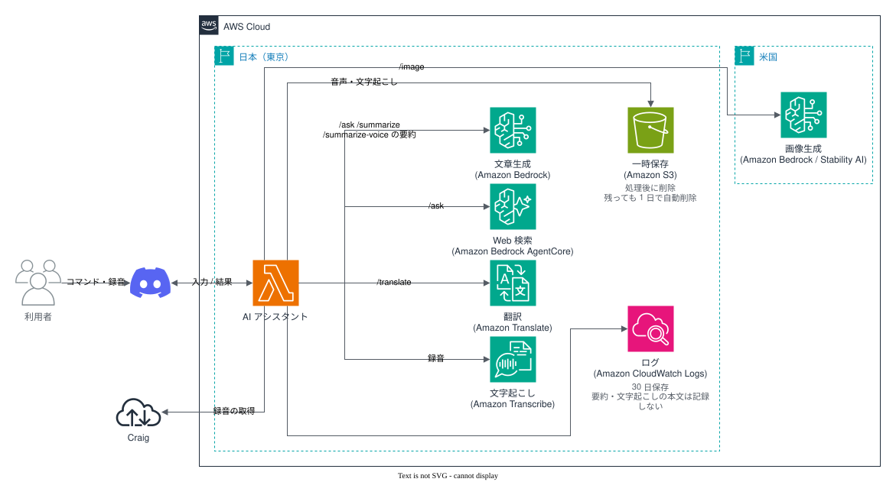

# 仕組みとデータの流れ

コマンドを実行してから結果が返るまでに、入力がどこへ送られ、どこに残るかを図で示します。

- AI アシスタントは AWS の東京リージョンで動きます。
- 文章生成・Web 検索・翻訳・文字起こしは、日本（東京）の AWS で処理します。
- `/image` の依頼文と元画像だけは、米国の AWS（Stability AI のモデル）へ送ります。
- 録音の音声と文字起こしは一時的に保存し、結果を投稿したあとに削除します。削除されずに残った場合も、1 日で自動的に削除されます。
- ログは 30 日保存します。要約や文字起こしの本文はログに記録しません。

送信先と保存の詳細は[プライバシーポリシー](privacy.md)を参照してください。

[目次に戻る](index.md)
